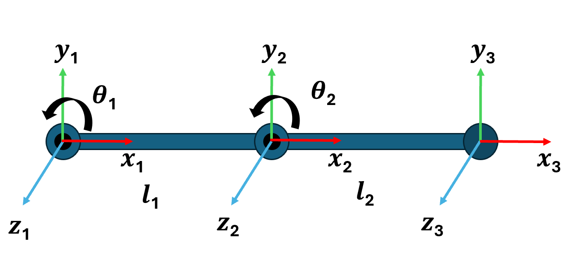
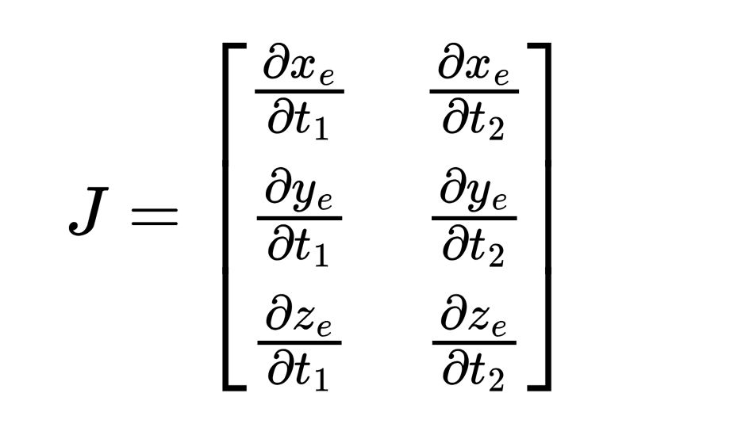
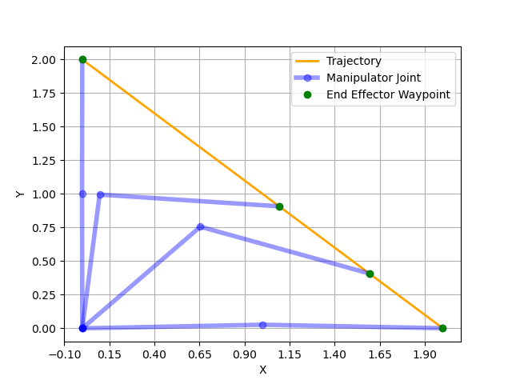

# Manipulation Control


***This class activity is to be done as individuals, not with partners nor with teams.***

### How to get started →

Begin by reading this entire writeup and making sure you have a good understanding of it. Next, spend some time planning how you’re going to approach the problem. 

## Introduction

---

In this class activity, you will be making use of forward and inverse kinematics, coupled with symbolic equations in python for controlling a 2D Planar Arm's end effector from one point to another.



>The image above depicts a 2D Planar manipulator with 2 joints, 2 links and an end effector

### Joint Space
Defined by the angles or positions of each individual joint in a robotic arm. Commands here control the angles or extensions of joints directly, ideal for achieving specific joint configurations. The command in the case of this activity is a joint velocity command 
$\dot{\theta}$ = [ $\dot{\theta_1}$ , $\dot{\theta_2}$]
The conversion from  joint space to cartesian is carried out through forward kinematics.

### Cartesian Space
Defined by the end-effector’s position and orientation in 3D space( in the case of this activity a 2D space -> [x, y]). The conversion from cartesian to joint space is carried out through inverse kinematics.

## Activity Information

---

### Objectives

- Using forward and inverse kinematics to calculate the joint command at each instant of time for the end effector to move from a given start point to a target. Any type of control (Proportional (P), Proportional Derivative (PD) or Proportional Derivative Integral (PID) control) can be used for this case. The end effector is considered to have reached the target if the distance between the end effector and the target is < 0.001 units.


### Resources

- [Kinematics](https://realitybytes.blog/2017/06/20/forward-and-inverse-kinematics-jacobians-and-differential-motion/) - Forward, Inverse Kinematics Theory and Jacobian Calculation
- [DH Convention](https://automaticaddison.com/how-to-find-denavit-hartenberg-parameter-tables) - Theory for DH Conventions
- [SymPy](https://docs.sympy.org/latest/tutorials/intro-tutorial/calculus.html) - Tutorials for sympy calculus, will be used to derive the Jacobian from the End Effector equations and the Anglular Symbols (t1, t2)
- [IKPY](https://ikpy.readthedocs.io/en/latest/) - An Inverse Kinematic Solver, just for reference

### Requirements
- Install the following required libraries using pip:
    ```
    pip3 install numpy sympy ikpy scipy matplotlib
    ```

### What we provide

- `manipulation.py`: Sample code that imports the relevant libraries and solves the control problem. No other libraries other than the ones mentioned can be used.
- `sympy_diff_example.ipynb`: Python notebook with an example matrix along with its jacobian calculation

### What to submit

You must submit your repo in the follow file structure

```bash
├──images
    ├── <imgs>
├──manipulation.py
├──sympy_diff_example.ipynb
```

*Please make sure you adhere to the structure above, if your package doesn’t match it the grader will give you a **zero***

### Grading considerations

- **Late submissions:** Carefully review the course policies on submission and late assignments. Verify before the deadline that you have submitted the correct version.
- **Environment, names, and types:** You are required to adhere to the names and types of the functions and modules specified in the release code. Otherwise, your solution will receive minimal credit.

### Part 1 - DH Parameters

D-H conventions are a convenient way to define frames of reference for a manipulator to get the homogenous transformation matrix. It consists of 4 parameters per link and joint (link length, link twist, link offset, and joint angle). You will define a 2x4 matrix representing the D-H parameters for the given manipulator configuration.

```python
class Manipulator:
    def __init__(self, ):
        self.thetas = sp.symbols("t1 t2")
        self.l1 = 1.0
        self.l2 = 1.0
        self.dh_params = np.array([[""" Your DH Params Go Here """]]) # 2D array of DH Parameters
```
Use the symbolic definitions in `self.dh_params`

### Part 2 - Create Jacobian

A jacobian is a matrix that relates joint velocities to the end-effector's velocity. For planar motion, the Jacobian is typically a 2×2 or 2×n matrix (depending on degrees of freedom) that helps with tasks like control, motion planning, and force analysis. For this section, the target Jacobian is as follows:



```python
def get_Jacobian_from_end_eqs(self, end_eff_eqs: sp.MutableDenseMatrix, angles):#the symbolic end effector equation and the symbolic angles
        J = []  # The Jacobian should be a 2D list of equations
        ######################################################
        #
        # Your code goes here
        # Use Sympy calculus to derive the Jacobian from the end effector equations and the symbolic angle variables (thetas = [t1, t2])
        #
        ######################################################
        return M(J)
```

From the [references](https://realitybytes.blog/2017/06/20/forward-and-inverse-kinematics-jacobians-and-differential-motion/), you can see that $x_e,y_e$ are functions of $\theta_1,\theta_2$. Use the steps in `sympy_diff_example.ipynb` to derive the Jacobian.

### Part 3 - PID Control

To perform control, we need to define the joint velocities of the end-effector. For a manipulator, it is possible to use the inverse of the Jacobian and the pose error of the end-effector to get the velocities.

```python
# This function returns the joint velocities as a ndarray
    def pid_control(self, t, cur_angles):  #Can be P, PD, or PID control
        q_dot = None
        ###############################################################
        # Your code for calculating the control goes here
        #
        # To evaluate the Jacobian for the particular angles, you can use
        # J_q = np.array(self.J.subs({'t1':cur_angles[0], 't2':cur_angles[1]}).evalf(), dtype = float)
        # Follow the Inverse Kinematics section at https://realitybytes.blog/2017/06/20/forward-and-inverse-kinematics-jacobians-and-differential-motion/
        # IMPORTANT: t is not utilized for this section. The integrator requires it
        ###############################################################
        return q_dot
```

`q_dot` can be defined in terms of P/PD/PID control analogous to Activity 4. Uses the current angles `cur_angles` and the target angles to compute the errors and specify any PID gains you wish to use. For this activity, `dt = 0.001`.



- Running the code `manipulation.py` should generate a plot as shown above
- The final position of the end effector should not be more than 0.001 units away from the target

## Submission and Assessment

---

Submit your code using the Github upload feature on [autolab](https://autolab.cse.buffalo.edu). 

**Note: Make sure your code complies to all instructions, especially the naming conventions. Failure to comply will result in zero credit.**

You will be graded on the following. Penalties are listed under each point, absolute values, w.r.t activity total.

1. Correct DH Parameters                                                                 (30%)
2. Correct Jacobian Formulation using sympy differentiation                              (30%)
3. Correct code for controlling the robot using using appropriate equation and gains     (30%)                      
4. Correct termination condition                                                         (10%)

